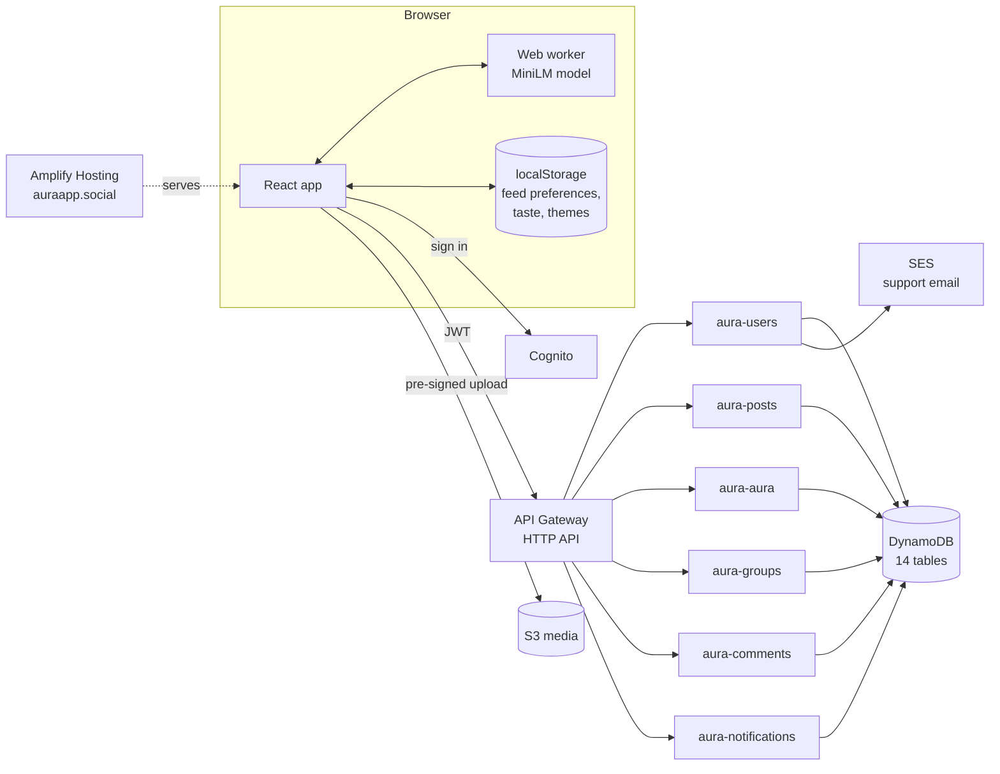

# Aura

[](https://github.com/The-Aura-App1/Aura-App-Official/actions/workflows/ci.yml)

**Live app: https://auraapp.social**

A social app where reputation is the currency. Instead of likes, people give **aura** to posts they value. Aura is free, earned, capped and audited on the server, and it can never be bought. The feed is ranked on your own device by what *you* ask to see, with no tracking. Aura has no cash value; creator payouts are on the [roadmap](#roadmap).

**Tech stack:** React 18 · Tailwind CSS 3 · AWS Amplify (hosting + auth) · Amazon Cognito · API Gateway (HTTP API) · AWS Lambda (Node.js 24, ESM) · DynamoDB · S3 · Amazon SES · Transformers.js (on-device AI) · Jest · GitHub Actions

---

## Contents

- [What it does](#what-it-does)
- [Angel, the on-device helper](#angel-the-on-device-helper)
- [Architecture](#architecture)
- [The private feed](#the-private-feed)
- [The aura economy](#the-aura-economy)
- [Games](#games)
- [Safety, privacy and security](#safety-privacy-and-security)
- [API routes](#api-routes)
- [Data model](#data-model)
- [Project structure](#project-structure)
- [Local development](#local-development)
- [Testing and CI](#testing-and-ci)
- [Deployment](#deployment)
- [Rubric alignment](#rubric-alignment)
- [Roadmap](#roadmap)
- [Changelog](CHANGELOG.md): everything that changed from 2026-10-27 to 2026-11-17, in detail

## What it does

| Feature | Details |
|---|---|
| **Accounts** | Email sign-up and sign-in via Cognito, onboarding, unique usernames, editable profile with pins and tags, a short guided tour that starts with picking a theme |
| **Posts** | Photo (up to 10 per post), video and text posts, made in three steps (create, edit, share) with a live preview. Up to 3 topics (Aura's own or your own custom topics), up to 10 hashtags, tagged people and a place name. Media uploads go straight to S3 with pre-signed URLs |
| **Post styling** | 276 self-hosted fonts, text colors, backgrounds (solid, gradient builder, 27 patterns), 28 preset frames plus a frame builder, and text, links, @mentions, hashtags and emoji placed anywhere on a photo, video or styled text card. Every value is checked by the server |
| **Aura** | Give aura to posts you value. Taking aura is opt-in per post and per group, and costs the taker the same amount (nobody profits from it). Daily free aura, caps and per-post limits, all enforced by the server |
| **Aura Wallet** | Balance split into *earned* (from others) and *spendable*, lifetime stats, a daily bonus, an optional rewarded ad, and a graph of your aura over time (week to all time) |
| **Feed** | Ranked on your device by your choices (topic chips, keywords, "show more/less like this") plus what it learns on your device from your gives, takes and likes. A Posts / Captions switch shows the feed as a list of captions |
| **Search** | People by name or username (with a switch to stay out of search), groups, and posts matched on your device by words, hashtags or meaning |
| **Following** | Follow anyone; private accounts approve each follower. Followers-only comments |
| **Reactions** | Any single emoji (or country flag) on posts and comments, with a deny list for letter-like and abusive ones |
| **Comments** | Threaded replies, @mentions that link to real profiles, reactions, and notifications for replies, tags and comments on your post |
| **Groups** | Open, request-to-join and invite-only groups with moderators. Groups earn XP and level up (to 15), unlocking a group picture, custom reaction pins, post backgrounds and a glow. Weekly Top Supporters, Spotlight, Aura Rain, Premium boosts, and Top groups and champions boards |
| **Games** | Nine group games for an aura stake or just for fun, plus bots at three levels (see [Games](#games)) |
| **Themes** | 13 themes, most with animated scenery (Day, Night, Snowy Peaks, Duskfall, City Skies, Northern Lights, Firefly Grove, Sky Isles, Abyss, Golden Dunes, Lantern Lake, plus plain Light and Dark). Premium's Theme Studio designs your own: every color, gradients, a scene or your own photo or video behind the app, fonts and shapes. Save up to 20 named themes |
| **Angel** | A helper that runs entirely on your device (see [below](#angel-the-on-device-helper)) |
| **Notifications** | Mark each one read or unread, star the ones to keep, filter All / Unread / Starred |
| **Suggestions & Reviews** | Post and vote on suggestions (500 aura once for your first). Star reviews appear on the welcome page once a moderator approves them |
| **Premium and creators** | Premium page with a Regular vs Premium comparison. The first 100 accounts get Premium free. A Creator page shows how each of your posts is doing (views, aura, aura per 100 views, top post) |
| **Moderation** | Block (works both ways), report posts, comments and accounts, a moderators' reports queue (keep, remove or ban), automatic hiding after 5 reports from established accounts. Every check runs on the server |

## Angel, the on-device helper

Angel is Aura's assistant, at `/angel`. She has **no generative model**, so she can't be talked into writing posts, making things up or going off topic. Everything runs in the browser and conversations are never saved or sent.

- **Understanding:** rules first, then a small trained intent classifier (`src/angel/intentModel.json`, about 7 KB) on top of the same on-device MiniLM sentence vectors the feed uses. It only chooses among her existing answers. Her limits run before anything else, including on a de-disguised copy of the message (leetspeak, spaced letters).
- **What she does:** tunes your feed, makes themes ("like Abyss but pink"), answers app questions from a fixed guide, gives feedback on a post draft (never writes it), reports trends by hashtag or topic, catches you up on notifications, and **finds a post you describe** ("that sunset photo I liked last week", "a post in my gym group about leg day") across your likes, your groups and popular posts.
- **Doing things:** she can give aura, like, share, join a group, accept a follow request and more, but every action shows a card with the exact post, person or amount, and nothing happens until you tap or say yes. A switch in Settings turns all of it off.
- **Tested:** hundreds of phrasings, including unseen sets written before tuning, in `src/angel/*.test.js`.

## Architecture



- **One Lambda per domain.** Each has a `response()` helper and one function per route. Every limit is enforced on the server, never only in the UI.
- **Only `aura-aura` writes balances**, and it logs every change with its earned/spendable split to `aura-transactions`. Games and power-ups live there too, so every stake, win and Aura Rain moves aura in one transaction.
- **Shared rules stay in sync.** Constants used by both the app and the server (topics, hashtags, fonts, styles, reactions, limits, stake caps and more) are checked by contract tests, so a change on one side fails CI until the other side matches.
- **Soft deletes.** Removed posts are kept with `status: 'removed'` and filtered from every read.

## The private feed

Most social feeds learn from everything you do and keep it on their servers. Aura's feed learns only from what you choose to do, and all of it stays on your device.

1. **The server sends everyone the same posts:** the top 100 by "hot score" (newness and aura), plus the top 20 for every topic. Because every request is identical, nothing about your interests can be inferred from it.
2. **You tune it:** tap a topic once for more, again for less. Type keywords like "jazz" or "vegan recipes", or use "Show more/less like this" on any post.
3. **It learns gently, on your device** (`src/utils/tasteProfile.js`): giving, taking and liking teach it a post's topics, hashtags and meaning, fading over a 30-day half-life. Your explicit choices always outweigh it. Settings > Privacy turns it off or resets it.
4. **Your device ranks it** (`src/utils/feedRanking.js`): boosts what you want, pushes down what you don't (never hides it), and keeps every 5th slot for something outside your choices so the feed doesn't become an echo chamber.

**On-device AI for keywords and search.** Keywords and search are matched by meaning, not spelling: "jazz" finds a post about a sax solo. A sentence-embedding model ([all-MiniLM-L6-v2](https://huggingface.co/Xenova/all-MiniLM-L6-v2), quantized, 23 MB) runs in a web worker in your browser:

- Authors' devices turn each caption, its topics and hashtags into a 384-number vector at post time, stored as a 512-character string.
- A keyword that exactly matches one of a post's hashtags ("live music" and #LiveMusic) always counts as a full match.
- Your keywords are turned into vectors on your device and compared with cosine similarity. Thresholds were measured on real text.
- The model and its runtime are **self-hosted** in this repo (`public/models`, checksum-verified in CI). Nothing loads from third parties.
- **Never tracked:** clicks, views, watch time and skipped posts play no part in ranking, and your preferences and learned taste are never sent to the server.

## The aura economy

| Rule | Regular | Premium |
|---|---|---|
| Daily login bonus | 200 | 800 |
| Free give quota per day | 50 | 200 |
| Give cap per day | 500 | 2,000 |
| Take cap per day | 250 | 1,000 |
| Game stakes per day | 500 | 2,000 |

- **Earned** aura only comes from other people giving to your posts. Everything else (login bonus, free quota, game winnings, ad rewards, Aura Rain, the first-suggestion bonus) is **spendable**.
- **Taking is a costly signal, not a weapon:** authors choose at posting time whether a post can be taken from (locked afterwards), group owners can make a group take-free, and taking costs the taker the same amount, which is destroyed rather than transferred. Ganging up on someone costs the group as much as it costs the target.
- **Anti-exploit:** max 500 earned per giver per day, gifts from accounts under 7 days old count as spendable, max 50 taken per post, playing for aura and catching Aura Rain need a 7-day-old account, a rewarded ad pays 25 at most once every 4 hours, and per-user rate limits apply to every action.
- Aura is never sold for money. Real money will only buy subscriptions and cosmetics.

## Games

Games are played inside groups, for an aura stake (held until the game ends, winner takes the pot as spendable aura) or friendly at 0. There is no house and no rake.

| Game | Players | Notes |
|---|---|---|
| Chess | 2 | Full rules (castling, en passant, promotion, every draw rule), chess clocks with increments, premoves. The move generator matches the standard perft counts |
| 8-Ball Pool | 2 | Real physics to scale: spin, stun, follow and draw, english off the rails. The server runs each shot and the app replays it |
| Mini Golf | 2–4 | Randomly generated holes that are always beatable, with sand, ice, slopes, windmills and mounds |
| Poker | 2–6 | No-limit Hold'em freezeout with side pots |
| Connect 4 | 2 | |
| Go Fish | 2–5 | |
| Crazy 8 | 2–4 | |
| Dice Duel | 2–6 | |
| Flip a Coin | 2 | |

- **The server deals, rolls and flips** (crypto-random), checks every move, and only ever sends each player their own view, never the deck or another player's cards.
- **Bots** (Pip, Nova and Atlas: easy, medium, hard) play every skill game just for fun, deciding only from their own seat's view.
- Every write is one transaction with a version check, so a lost race moves no aura.

## Safety, privacy and security

**Rate limiting, in two layers.**

1. **API Gateway throttling** on the whole API: 50 requests a second, bursts of 100. Lower per-route limits sit on top for the routes that create things or cost money: sign-up and reports 3/s, posting, post uploads and the daily bonus 10/s, group creation, other uploads, feedback, support and ad rewards 5/s.
2. **Per-account limits inside every Lambda**, as fixed-window counters in `aura-rate-limits` (HTTP 429 when exceeded). A few examples:

| Action | Limit per account |
|---|---|
| Posting | 5 a minute, 30 an hour |
| Comments | 10 a minute, 100 an hour |
| Giving or taking aura | 30 a minute, 300 an hour |
| Follows | 30 a minute, 400 a day |
| Reports | 10 an hour |
| Suggestions / support | 3 a day / 3 an hour (8 a day) |
| Games against bots | 30 moves a minute, 600 an hour |
| Rewarded ads | one payout every 4 hours |

The full table is in the [changelog](CHANGELOG.md#security-and-abuse-prevention). The limiter fails open on purpose, so a problem with its table can never take the API down.

**Abuse prevention.**
- **New accounts can't be used to cheat:** gifts from accounts under 7 days old count as spendable, playing for aura and catching Aura Rain need a 7-day-old account, and only reports from 7-day-old accounts can hide a post.
- **Banned accounts** can't post, comment, react, report, follow, move aura, or create, join or moderate groups.
- **Rewarded ads** pay only after a one-time server session that's 15 seconds to 15 minutes old.
- **Uploads** use pre-signed S3 URLs valid for 10 minutes and fixed to one type and size: JPEG, PNG or WEBP up to 20 MB, MP4 or MOV up to 500 MB.

**Input and output.**
- Text people write is cleaned on the server by one shared module (`text.mjs`): control, invisible and direction-flipping characters are removed, and lengths are capped. Names that pose as Aura staff are refused.
- Every style, font, overlay, reaction, topic and tag is checked against the same lists the app uses, and unknown fields are dropped.
- Bodies that aren't JSON objects get a 400, ids in paths are URL-encoded and checked, and errors never include stack traces.
- Responses use allowlists: public profiles and comments return only listed fields, so report details and others' like counts never leak.
- No user HTML is ever rendered, and links on posts accept only http(s) and open with `noopener noreferrer nofollow`.

**Privacy.**
- Private accounts show their posts only to approved followers. One shared module (`privacy.mjs`) makes that check in every Lambda.
- Blocking works both ways across posts, comments, aura, follows, tags, games and search.
- Feed learning, preferences and Angel conversations never leave the device.

**Hosting.**
- An enforced Content Security Policy, HSTS, X-Frame-Options and other headers (`customHttp.yml`), with no inline scripts.
- Feed ads run in Google's Limited Ads mode (no cookies or device IDs), forced into the sandboxed cross-origin SafeFrame so ad code can't reach the page or sign-in tokens.
- **Least-privilege IAM:** each Lambda's role has only the tables and actions it uses (`backend/iam/`).

**Known gaps,** tracked in [`docs/security-checklist.md`](docs/security-checklist.md):
- API and upload CORS still allow any origin. Low risk, because requests carry a bearer token, not cookies.
- Media files are readable by anyone with their random address.
- AWS WAF isn't used yet: it can't attach to HTTP APIs, and the paid options are deferred.

## API routes

All routes require a Cognito JWT except where the gateway allows otherwise.

| Lambda | Routes |
|---|---|
| `aura-users` | `POST /users` · `GET/PUT /users/me` (profile, settings, theme design, Premium claim) · `POST /users/me/upload-urls` · `GET /users/{username}` · `/follows/*` (follow, requests, block, report, people search) · `/feedback/*` (suggestions, votes, reviews, support) · `POST /admin/ban`, `GET /admin/reports`, `POST /admin/review` (moderator only) |
| `aura-posts` | `GET /posts` (feed pools) · `POST /posts` · `GET/DELETE /posts/{id}` · `POST /posts/{id}/report` · `POST /{posts\|comments}/{id}/reactions` · `POST /posts/upload-urls` · `POST /posts/fix-author` · `POST/DELETE /{posts\|comments}/{id}/like` · `GET /users/{id}/posts` · `GET /users/me/likes` · `GET /groups/{id}/posts` |
| `aura-aura` | `POST /{target}/{id}/aura/give` · `POST /{target}/{id}/aura/take` · `POST /aura/daily-bonus` · `POST /ads/watch` · `GET /aura/history/{userId}` · `/games/*` (challenges, moves, bots, champions) · `/power-ups/*` (Spotlight, Aura Rain, boosts) |
| `aura-groups` | `GET/POST /groups` · `GET /groups/mine` · `GET /groups/leaderboard` · `GET/PUT/DELETE /groups/{id}` · `GET /groups/{id}/members` · `POST /groups/{id}/upload-url` · `POST /groups/{id}/{join\|leave\|invite\|mute}` · member moderation |
| `aura-comments` | `GET/POST /posts/{id}/comments` · `DELETE /comments/{id}` · `POST /comments/{id}/report` |
| `aura-notifications` | `GET /notifications` · `PUT /notifications/{id}/read` · `PUT /notifications/{id}/star` · `PUT /notifications/read-all` · `DELETE /notifications/{id}` |

## Data model

| Table | Holds |
|---|---|
| `aura-users` | Profiles, balances, lifetime counters, plus `USERNAME#<name>` reservation items that keep usernames unique |
| `aura-posts` | Posts with denormalized author info, topics, caption vector, style, overlays, reactions, aura totals and status |
| `aura-transactions` | Audit log of every aura change |
| `aura-daily-budgets` | Daily usage per user and per source, balance history, ad sessions |
| `aura-groups` / `aura-group-members` / `aura-group-stats` | Groups, roles and membership; levels, XP, weekly supporters, game wins |
| `aura-comments` / `aura-likes` | Comments; private likes and each person's reactions |
| `aura-follows` | Follows, follow requests and blocks |
| `aura-games` | Game matches and their state (finished games kept 60 days) |
| `aura-feedback` | Suggestions, votes, reviews, support tickets |
| `aura-notifications` | Per-user notifications |
| `aura-rate-limits` | Per-user rate-limit counters |

## Project structure

```
src/
  pages/            Feed, Search, Profile, CreatePost, Groups, GameMatch, AuraWallet, Angel,
                    ThemeStudio, Premium, Creator, Settings, Moderation, About, auth screens
  components/       post, feed, groups, games, profile, scenes, tour, moderation and layout
  angel/            Angel's rules, skills, actions, flows and intent model
  themes/           built-in themes, custom themes, Theme Studio designs
  ads/              Google Ad Manager (Limited Ads)
  utils/            feedRanking, tasteProfile, feedPrefs, embeddings, postDesign and other
                    pure, unit-tested logic
  workers/          embed.worker.js: runs the AI model off the main thread
  backendContract.test.js   keeps app and Lambda constants in sync
backend/lambdas/    one folder per Lambda (index.mjs plus its modules, e.g. games and bots)
backend/tests/      server tests run with npm run test:games
backend/iam/        each Lambda's least-privilege IAM policy
public/models/      self-hosted embedding model
public/fonts/post/  self-hosted post fonts
scripts/            build helpers, phone layout and speed audits, Angel's intent training
deploy.ps1          deploys one Lambda
amplify.yml         Amplify build settings
customHttp.yml      security headers
```

## Local development

Requires Node.js 24.

```powershell
git clone https://github.com/The-Aura-App1/Aura-App-Official.git
cd Aura-App-Official
npm install --legacy-peer-deps
npm start            # http://localhost:3000, talks to the live dev API
```

`npm start` and `npm run build` first run `scripts/copy-ort.js`, which copies the model runtime into `public/ort` (generated, not committed).

## Testing and CI

```powershell
npm test -- --watchAll=false   # 48 app test files (Jest)
npm run test:games             # 14 server test files
```

| Area | Covers |
|---|---|
| Feed and search | Boosting, demoting, exploration slots, keyword and meaning matching, the learned taste, people search |
| Angel | Hundreds of phrasings, unseen sets written before tuning, multi-turn conversations, actions only after a yes |
| Contracts | Topics, hashtags, fonts, styles, reactions, limits and stake caps match between the app and the Lambdas; the model file's SHA-256 matches the original |
| Games | Thousands of random games checking each rule set's invariants, chess perft counts, every table size and players leaving, chess clocks through the real handler, bot against bot at every level, a solver that holes random golf courses |
| Server features | Group levels and perks, reactions on comments, post overlays and design, custom topics, tagged people, Premium claims, support, the first-suggestion bonus |
| Phones | `scripts/phone-audit.mjs` opens every page at 8 sizes from 360 to 1024 px wide and fails on sideways overflow |

Every push and pull request runs [GitHub Actions](.github/workflows/ci.yml): Lambda syntax check → all app tests → production build. The badge at the top shows the latest result.

## Deployment

- **Web:** pushing to `master` triggers an AWS Amplify build (`amplify.yml`) and deploys to https://auraapp.social (domain on Cloudflare DNS, certificate managed by Amplify).
- **Lambdas:** `.\deploy.ps1 -Name <lambda>` zips and deploys one function, then prints its `LastModified` to confirm.
- **Rollback:** every deploy comes from a commit. To roll back, check out the last good version of the file and redeploy it.

## Rubric alignment

| Category | Points | How this repo addresses it |
|---|---|---|
| Problem Definition & Relevance | 10 | Social feeds track everything users do. Aura ranks only by choices users make on purpose, keeps that learning on their device, and replaces likes with a capped, audited reputation currency |
| **AI Feature Innovation & Integration** | **20** | **Sentence-embedding model running entirely in the browser (web worker, self-hosted) · meaning-based keywords and post search · vectors computed on the author's device and validated by the server · private on-device re-ranking with exploration slots · Angel: an on-device helper with a trained intent classifier, describe-a-post search, and actions only after consent, with no generative model to misuse** |
| Technical Execution & Code Quality | 20 | Serverless AWS (6 Lambdas, 14 DynamoDB tables) · every limit enforced server-side · transactional aura moves · server-authoritative games with real physics · contract tests that catch app/server drift · CI green |
| User Experience & Design | 10 | 13 themes with animated scenery and a Theme Studio · step-by-step posting with live preview · guided tour · phone layout audited at 8 sizes · motion that answers every give, take and press |
| Business Impact & Scalability | 10 | Revenue from subscriptions, cosmetics and non-personalized ads, never aura sales or user data · creator payouts deferred until payments and money-transmission rules are handled · anti-exploit rules · feed requests are the same for every user, so the client's work stays constant as posts grow |
| GitHub Transparency | 10 | Small, focused commits with descriptive messages · iterative build visible in history · CI on every push |
| Documentation & Communication | 10 | This README · [detailed changelog](CHANGELOG.md) · architecture diagram · API and data model tables · security checklist · in-app About page, FAQ and privacy notes |
| Deployment & Live Demo | 10 | Live at https://auraapp.social on AWS Amplify, HTTPS, auto-deploys on push · seeded demo accounts and a judge login |

## Roadmap

The user-facing part of this roadmap is also on the About page.

**Done**

- [x] Posts, aura give/take, earned/spendable split, daily limits
- [x] Aura Wallet with balance history, Settings, groups, comments, likes, notifications
- [x] Private, preference-based feed with on-device AI keywords and on-device taste learning
- [x] Following, private accounts and follow requests
- [x] Blocking, reports on posts, comments and accounts, and a moderation queue
- [x] Site moderation: remove any post or comment, ban and unban accounts
- [x] Take-aura safeguards: opt-in per post (locked once posted), take-free groups, and taking costs the taker the same amount
- [x] Search for people, groups and posts
- [x] Group games for aura, never money (chess, pool, mini golf, poker and more), plus bots
- [x] Group levels, perks, Spotlight, Aura Rain and boosts; Top groups and champions boards
- [x] Post styling, overlays, emoji reactions, custom topics, tagged people and places
- [x] Animated themes, custom themes and the Premium Theme Studio
- [x] Angel, the on-device helper
- [x] Suggestions & Reviews, Premium and Creator pages
- [x] Security pass: rate limits and API throttling, upload limits, input cleaning, least-privilege IAM, enforced Content Security Policy
- [x] Custom domain: https://auraapp.social
- [x] Seeded demo accounts and posts (no real user data needed to try the app)

**Next up**

- [ ] Buying Aura Premium (ad-free, more aura each day, Theme Studio and more). The first 100 accounts already have it free
- [ ] Moments: group-only photos that disappear after 24 hours

**Soon**

- [ ] iOS and Android apps (React Native)
- [ ] Badges, and a global aura rank you can hide

**Later**

- [ ] Creator payouts, once payment and money-transmission compliance is in place
- [ ] Direct messages

**Engineering before launch**

- [ ] Replace table scans with DynamoDB indexes (per-topic feed lists, group lists) and a server search index for all posts
- [ ] Creator analytics, phase 2: daily per-post counters, top supporters, follower growth
- [ ] Lock API and media-upload CORS to the app's domain; consider a web application firewall as traffic grows
- [ ] Sign in with Google (built, waiting on Cognito setup)
