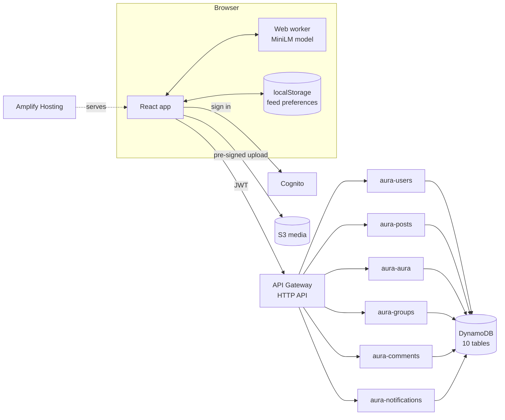

# Aura

[](https://github.com/The-Aura-App1/Aura-App-Official/actions/workflows/ci.yml)

**Live app: https://master.d81n9jit8j6my.amplifyapp.com**

A social app where reputation is the currency. Instead of likes, people give (or take) **aura** on posts. Aura is earned, capped and audited on the server, and creators will be able to cash out what others give them. The feed is ranked by what *you* ask to see, with no tracking.

**Tech stack:** React 18 · Tailwind CSS 3 · AWS Amplify (hosting + auth) · Amazon Cognito · API Gateway (HTTP API) · AWS Lambda (Node.js 24, ESM) · DynamoDB · S3 · Transformers.js (on-device AI) · Jest · GitHub Actions

---

## Contents

- [What it does](#what-it-does)
- [Architecture](#architecture)
- [The private feed](#the-private-feed)
- [The aura economy](#the-aura-economy)
- [API routes](#api-routes)
- [Data model](#data-model)
- [Project structure](#project-structure)
- [Local development](#local-development)
- [Testing and CI](#testing-and-ci)
- [Deployment](#deployment)
- [Rubric alignment](#rubric-alignment)
- [Roadmap](#roadmap)

## What it does

| Feature | Details |
|---|---|
| **Accounts** | Email sign-up and sign-in via Cognito, onboarding, unique usernames, editable profile, light and dark themes |
| **Posts** | Photo, video and text posts with up to 3 preset topics and up to 10 custom hashtags; media uploads go straight to S3 with pre-signed URLs |
| **Aura** | Give or take aura on posts. Daily free aura, daily give/take caps and per-post limits, all enforced by the server |
| **Aura Wallet** | Balance split into *earned* (cashable later) and *spendable*, lifetime stats; aura timeline graph on profiles |
| **Feed** | Ranked on your device by your explicit choices: topic chips, free-text keywords, "show more/less like this" |
| **Groups** | Open, request-to-join and invite-only groups, moderators, muting and group-only posts |
| **Comments and likes** | Comments with reporting. Likes are a private bookmark: only the author sees the count |
| **Notifications** | In-app notifications with read/unread state |
| **Post deletion** | Authors delete from their profile; moderators can remove group posts. Deleted posts disappear from every feed |

## Architecture



- **One Lambda per domain.** Each has a `response()` helper and one function per route. Every limit is enforced on the server, never only in the UI.
- **Only `aura-aura` writes balances**, and it logs every change with its earned/spendable split to `aura-transactions`.
- **Soft deletes.** Removed posts are kept with `status: 'removed'` and filtered from every read.

## The private feed

Most social feeds learn from everything you do. Aura's feed only uses what you explicitly tell it, and those choices never leave your device.

1. **The server sends everyone the same posts:** the top 100 by "hot score" (newness and aura), plus the top 20 for every topic. Because every request is identical, nothing about your interests can be inferred from it.
2. **You tune it:** tap a topic once for more, again for less. Type keywords like "jazz" or "vegan recipes", or use "Show more/less like this" on any post.
3. **Your device ranks it** (`src/utils/feedRanking.js`): boosts what you want, pushes down what you don't (never hides it), and keeps every 5th slot for something outside your choices so the feed doesn't become an echo chamber.

**On-device AI for keywords.** Keywords are matched by meaning, not spelling: "jazz" finds a post about a sax solo. A sentence-embedding model ([all-MiniLM-L6-v2](https://huggingface.co/Xenova/all-MiniLM-L6-v2), quantized, 23 MB) runs in a web worker in your browser:

- Authors' devices turn each caption, its topics and hashtags into a 384-number vector at post time, stored as a 512-character string.
- A keyword that exactly matches one of a post's hashtags ("live music" and #LiveMusic) always counts as a full match.
- Your keywords are turned into vectors on your device and compared with cosine similarity. Thresholds were measured on real text.
- The model and its runtime are **self-hosted** in this repo (`public/models`, checksum-verified in CI). Nothing loads from third parties.
- **Never tracked:** clicks, views, watch time and likes play no part in ranking.

## The aura economy

| Rule | Regular | Premium |
|---|---|---|
| Daily login bonus | 200 | 800 |
| Free give quota per day | 50 | 200 |
| Give cap per day | 500 | 2,000 |
| Take cap per day | 250 | 1,000 |

- **Earned** aura (cashable) only comes from other people giving to your posts. Everything else is **spendable** and never cashable.
- **Anti-exploit:** max 500 earned per giver per day, gifts from accounts under 7 days old count as spendable, max 50 taken per post.
- Aura is never sold for money. Real money only buys subscriptions and cosmetics.

## API routes

All routes require a Cognito JWT except where the gateway allows otherwise.

| Lambda | Routes |
|---|---|
| `aura-users` | `POST /users` · `GET/PUT /users/me` · `POST /users/me/upload-urls` · `GET /users/{username}` |
| `aura-posts` | `GET /posts` (feed pools) · `POST /posts` · `GET/DELETE /posts/{id}` · `POST /posts/upload-urls` · `POST /posts/fix-author` · `POST/DELETE /{posts\|comments}/{id}/like` · `GET /users/{id}/posts` · `GET /users/me/likes` · `GET /groups/{id}/posts` |
| `aura-aura` | `POST /{target}/{id}/aura/give` · `POST /{target}/{id}/aura/take` · `POST /aura/daily-bonus` · `POST /ads/watch` |
| `aura-groups` | `GET/POST /groups` · `GET /groups/mine` · `GET/PUT/DELETE /groups/{id}` · `GET /groups/{id}/members` · `POST /groups/{id}/{join\|leave\|invite\|mute}` · member moderation |
| `aura-comments` | `GET/POST /posts/{id}/comments` · `DELETE /comments/{id}` · `POST /comments/{id}/report` |
| `aura-notifications` | `GET /notifications` · `POST /notifications/send` · `PUT /notifications/{id}/read` · `PUT /notifications/read-all` · `DELETE /notifications/{id}` |

## Data model

| Table | Holds |
|---|---|
| `aura-users` | Profiles, balances, lifetime counters, plus `USERNAME#<name>` reservation items that keep usernames unique |
| `aura-posts` | Posts with denormalized author info, topics, caption vector, aura totals and status |
| `aura-transactions` | Audit log of every aura change |
| `aura-daily-budgets` | Daily usage per user and per source, keyed by UTC date |
| `aura-groups` / `aura-group-members` | Groups, roles and membership status |
| `aura-comments` / `aura-likes` / `aura-shares` | Comments, private likes, shares |
| `aura-notifications` | Per-user notifications |

## Project structure

```
src/
  pages/            Feed, Profile, CreatePost, Groups, AuraWallet, Settings, auth screens
  components/       post, feed, groups, profile and layout components
  utils/            feedRanking, feedPrefs, embeddings, topics (pure, unit-tested logic)
  workers/          embed.worker.js: runs the AI model off the main thread
  backendContract.test.js   keeps app and Lambda constants in sync
backend/lambdas/    one folder per Lambda (index.mjs)
public/models/      self-hosted embedding model
scripts/copy-ort.js copies the ONNX runtime into public/ort before each build
deploy.ps1          deploys one Lambda
amplify.yml         Amplify build settings
```

## Local development

Requires Node.js 24.

```powershell
git clone https://github.com/The-Aura-App1/Aura-App-Official.git
cd Aura-App-Official
npm install --legacy-peer-deps
npm start            # http://localhost:3000, talks to the live dev API
```

`npm start` and `npm run build` first run `scripts/copy-ort.js`, which copies the model runtime into `public/ort` (generated, not committed).

## Testing and CI

```powershell
npm test -- --watchAll=false
```

| Test file | Covers |
|---|---|
| `feedRanking.test.js` | Boosting, demoting, exploration slots, keyword matching |
| `feedPrefs.test.js` | Saving, loading and validating preferences, per-user storage, corrupt-data recovery |
| `embeddings.test.js` | Vector encoding round trips, similarity, invalid input |
| `backendContract.test.js` | Topics, embedding settings and daily limits match between the app and the Lambdas; the server's vector validator accepts real app output; the model file's SHA-256 matches the original |

Every push and pull request runs [GitHub Actions](.github/workflows/ci.yml): Lambda syntax check → all tests → production build. The badge at the top shows the latest result.

## Deployment

- **Web:** pushing to `master` triggers an AWS Amplify build (`amplify.yml`) and deploys to the live URL.
- **Lambdas:** `.\deploy.ps1 -Name <lambda>` zips and deploys one function, then prints its `LastModified` to confirm.
- **Rollback:** every deploy comes from a commit. To roll back, check out the last good version of the file and redeploy it.

## Rubric alignment

| Category | Points | How this repo addresses it |
|---|---|---|
| Problem Definition & Relevance | 10 | Social feeds track everything users do. Aura ranks only by choices users make on purpose, and replaces likes with a capped, audited reputation currency |
| **AI Feature Innovation & Integration** | **20** | **Sentence-embedding model running entirely in the browser (web worker, self-hosted) · meaning-based keyword matching · vectors computed on the author's device and validated by the server · private on-device re-ranking with exploration slots** |
| Technical Execution & Code Quality | 20 | Serverless AWS (6 Lambdas, 10 DynamoDB tables) · every limit enforced server-side · soft deletes · pure, unit-tested ranking logic · contract tests that catch app/server drift · CI green |
| User Experience & Design | 10 | Light and dark themes · responsive layout with mobile nav · "Tune your feed" panel · infinite scroll · two-tap delete confirmation |
| Business Impact & Scalability | 10 | Creator cashouts funded by subscriptions, never aura sales · anti-exploit rules · feed requests are the same for every user, so the client's work stays constant as posts grow |
| GitHub Transparency | 10 | Small, focused commits with descriptive messages · iterative build visible in history · CI on every push |
| Documentation & Communication | 10 | This README · architecture diagram · API and data model tables · in-app privacy notice ("Saved only on this device") |
| Deployment & Live Demo | 10 | Live on AWS Amplify at https://master.d81n9jit8j6my.amplifyapp.com, HTTPS, auto-deploys on push |

## Roadmap

- [x] Posts, aura give/take, earned/spendable split, daily limits
- [x] Aura Wallet, Settings, groups, comments, likes, notifications
- [x] Post deletion
- [x] Private, preference-based feed with on-device AI keywords
- [ ] Custom domain
- [ ] Follow system and private accounts
- [ ] Indexed per-topic feed lists (replace table scans)
- [ ] Post customization, group games, Moments, search, leaderboard
- [ ] Payments (Stripe), creator verification and cashouts
- [ ] Security pass: WAF, rate limits, signed media URLs
- [ ] React Native app for iOS and Android
